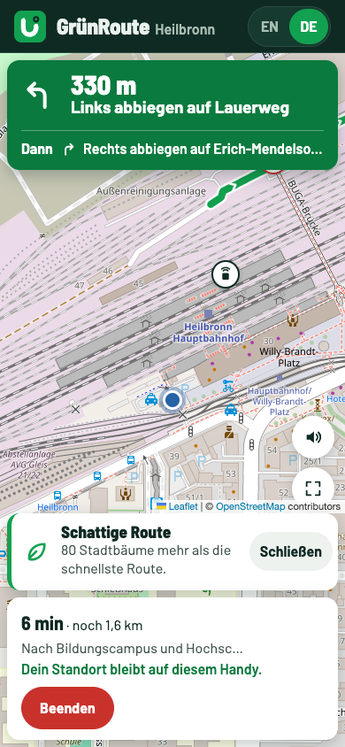
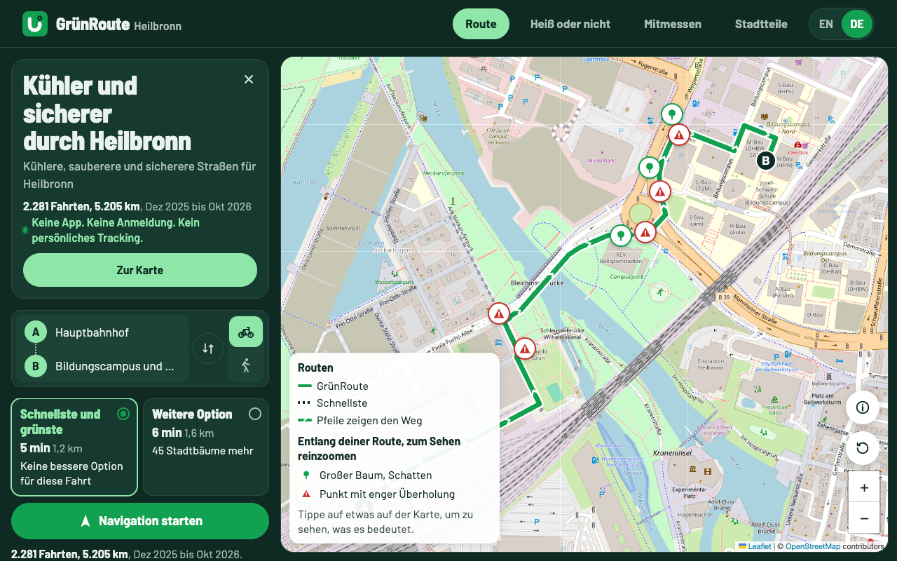
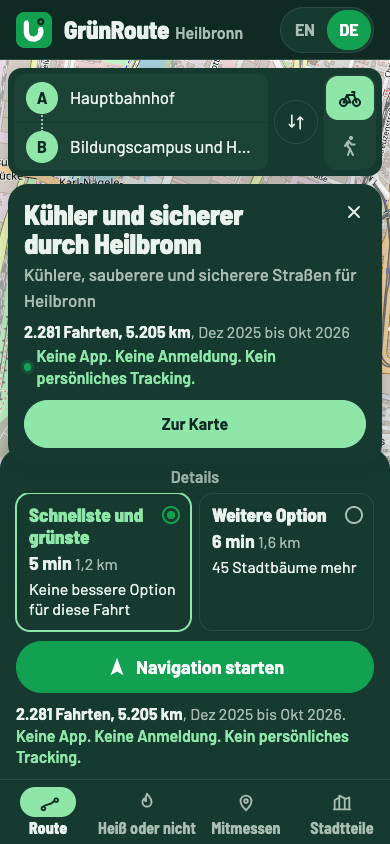
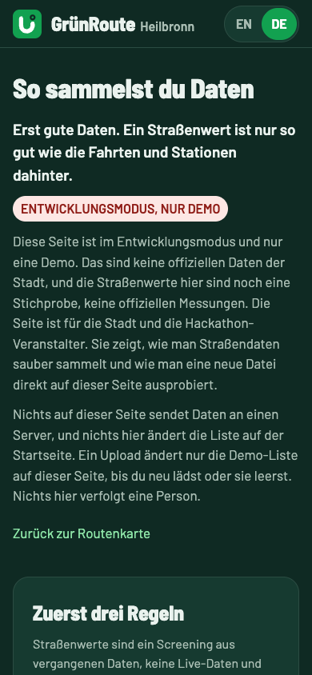
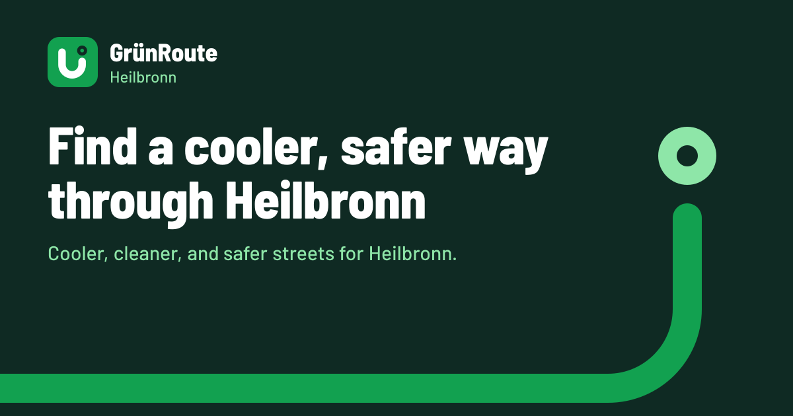
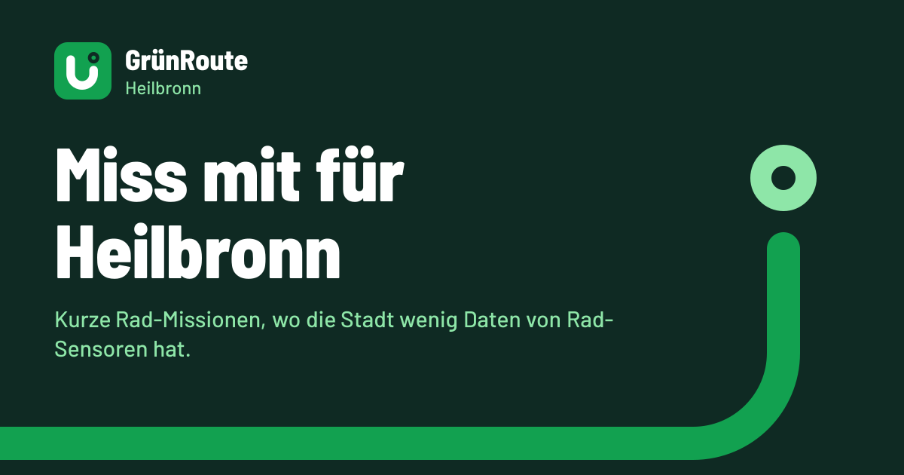

# QA: English and German, and social sharing (28 Oct 2026)

Branch `i18n-seo`, local only, not pushed. Tested on a production build (`next start`) on localhost.

## What changed

- The people app is now in English and German. English stays at the plain URLs (`/`, `/play`, `/measure`, `/districts`, `/data-collection`). German lives under `/de` (`/de`, `/de/play`, and so on).
- EN and DE switch in the header of every page. The choice is kept in a `lang` cookie for a year.
- `proxy.ts` handles language routing:
  - `/en/...` redirects (308) to the plain URL.
  - A plain URL redirects (307) to `/de/...` when the cookie says German, or on a first visit when the browser ranks German above English.
  - Link preview bots and search bots are never redirected, so a shared link always shows the language of that link.
- German uses informal "du".
- Every page has its own title, description, canonical link, hreflang links (en, de, x-default), Open Graph tags (site name, url, locale, alternate locale) and Twitter `summary_large_image` tags.
- Each page has a share image (1200 x 630) in both languages, made with `next/og` in the brand style. The old "Which street should Heilbronn fix first?" share image was removed.
- New files: `app/sitemap.ts` (both languages, with alternates) and `app/robots.ts`. The home page also has JSON-LD (`WebApplication`).
- The manifest description now says "Find a cooler, safer way through Heilbronn...".
- Key files: `app/[lang]/`, `proxy.ts`, `lib/i18n.ts`, `lib/seo.ts`, `lib/og.tsx`, `components/LangProvider.tsx`, `components/LangSwitch.tsx`.

## Checks done

| Check | Result |
|---|---|
| Root: lint, `npm test`, build | clean, 53/53, OK |
| Planner (`admin/`): lint, `npm test`, build | clean, 19/19, OK |
| All 10 page URLs (5 pages x 2 languages), sitemap.xml, robots.txt | 200 |
| `/de/xyz`, `/nope` | 404 (German and English not found page) |
| 20 share images (5 pages x 2 languages x OG and Twitter) | 200, PNG, about 50 KB each |
| Meta tags on `/de/measure` (curl as Twitterbot) | German title and description, canonical, hreflang, og:locale de_DE, image with size, type and alt |
| Switch: EN to DE on `/` | goes to `/de`, `html lang="de"`, cookie `lang=de` |
| Plain `/districts` with cookie de | lands on `/de/districts` |
| Switch: DE to EN | goes to `/districts`, cookie `lang=en`, plain URLs stay English |
| `/en/measure` | redirects to `/measure` |
| German Accept-Language, first visit (curl) | 307 to `/de/...` |
| WhatsApp, Twitterbot user agents | 200, no redirect |
| Links on `/de/play` | tabs and footer keep the `/de` prefix |
| 390 px wide, all 10 pages | no horizontal overflow |
| Page errors, all 10 pages | none |
| Leftover English on `/de` pages (text scan) | fixed two: source names and "Unnamed street near X" on Measure. Dataset ids (for example `ATRAI bumpy_roads_heilbronn`) and the map credit "© OpenStreetMap contributors" stay as they are. |
| German From picker, Play round | fully German, numbers with decimal comma (-1,4 °C) |

## Second pass, after merging origin/main (Planner PRs 16 and 17)

- Root: lint clean, 53/53, build OK. Planner: lint clean, 19/19, build OK.
- Browser, normal Chrome user agent: EN to DE switch, the German tabs (Mitmessen, Stadtteile), plain `/play` with cookie de goes to `/de/play`, DE to EN switch, all with the right `html lang`, cookie and page title.
- German trip planner: changed To to Theresienwiese and switched to Zu Fuß, routes came back in German ("GrünRoute 25 min 2,1 km, Mehr Bäume pro km").
- `/de?fair=1` loads in German.
- 390 px, all 10 pages: no horizontal overflow, no page errors.
- Live directions: with location blocked, the German message "Standort ist blockiert" shows. After allowing location, the public routing server (routing.openstreetmap.de) stopped accepting connections from this machine (curl also failed, openstreetmap.org was fine), so the app showed its German "Der Routendienst hat nicht geantwortet" message. That is the external service, likely rate limiting after many test loads, not this change.

## Backup router (Valhalla), added the same day

On 28 Oct 2026 the public OSRM server (routing.openstreetmap.de) refused all connections, from this machine and from other networks, and the live site showed "The route service did not answer". The owner asked for a backup.

- `lib/valhalla.ts`: asks Valhalla (valhalla1.openstreetmap.de, also FOSSGIS, same OpenStreetMap data, CORS open) and turns its answer into the OSRM route shape: line, metres, seconds, and turn steps (maneuver numbers mapped to OSRM types, so `lib/nav.ts` reads them the same in both languages).
- `lib/routing.ts`: OSRM first, with an 8 second limit. If it fails (down, timeout, server error), the backup answers, and OSRM is skipped for 5 minutes. "No route" from OSRM is not an outage and does not switch.
- Listed in `lib/sources.ts` and in "How routes are chosen" (EN and DE).
- `tests/valhalla.test.mjs`: line decoding and step mapping. Root tests 55/55, Planner 19/19, both build.
- Browser, with OSRM really down: English and German routes with alternatives, To changed to Theresienwiese, Walk mode, and live directions started with a stubbed position in both languages ("Turn left onto Lauerweg", "Links abbiegen auf Lauerweg"). Screenshot: 
- Full EN and DE pass again after the change: switch, tabs, cookie redirect, titles, all 11 pages at 390 px with no overflow and no page errors.
- Not checked: the OSRM path itself, since OSRM was down the whole time. Its code is the same as before apart from the 8 second limit.

## Not checked

- Real phones. The checks used headless Chrome at 1280 px and 390 px wide.
- Live directions in German past the start screen (the spoken cues have unit tests in `tests/nav.test.mjs`, but no ride was simulated in the browser, see above).
- Real link previews on WhatsApp, X, LinkedIn or Facebook. This needs the deployed URL. After deploying, test with the platforms' own preview tools.
- Search Console indexing.

## Notes

- Switching language reloads the page, so a chosen From and To resets.
- The test browser sends "HeadlessChrome", which counts as a bot, so the cookie redirect was tested in the browser with a normal Chrome user agent.

## Screenshots

- German home, desktop: 
- German home, 390 px: 
- German data collection page, 390 px: 
- Share image, English home: 
- Share image, German Measure: 
