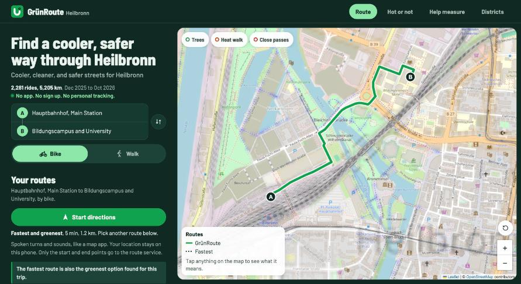
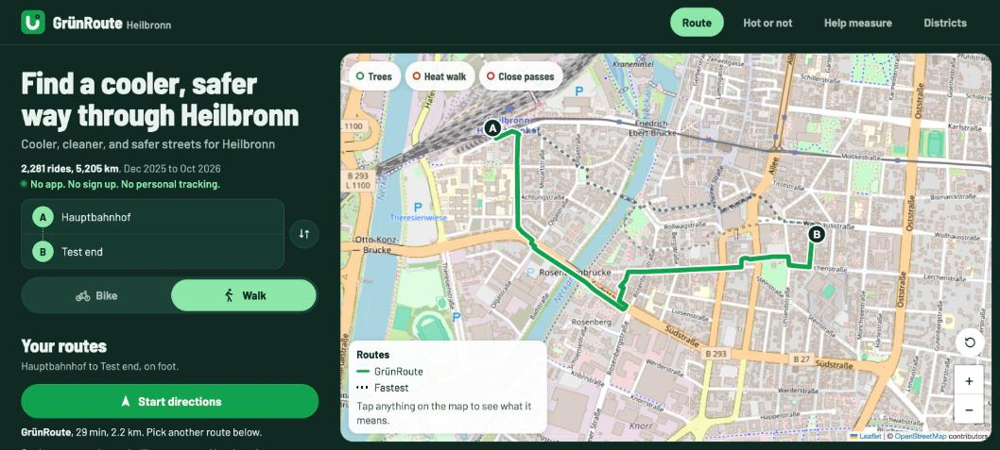
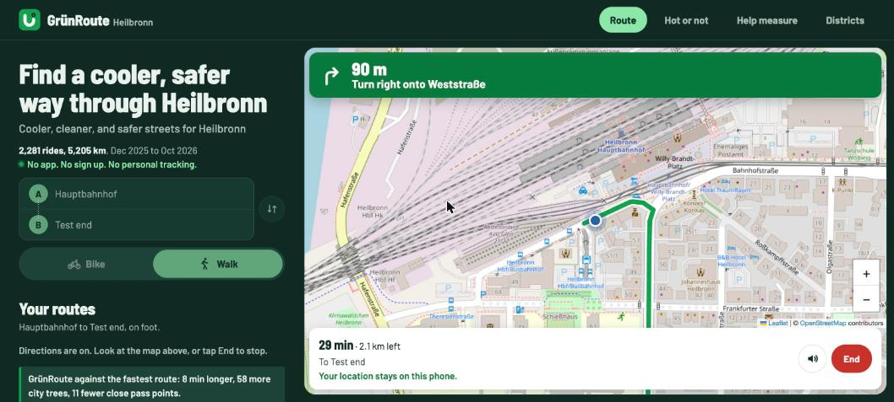

# Map first layout and gamified map, people app, 28 Oct 2026 (branch `map-ux`)

Scope: the people app only. Nothing in `admin/` changes, only the shared root `lib/` syncs into it.
Widths: 390 x 750 px (an iframe in a desktop Chrome tab, shown at 0.9 scale) and desktop (1512 x 682 viewport, shown at 0.7 scale). Chrome ran in dark mode.
Not checked: a real phone, Safari, the on screen keyboard, screen readers.

Images are in [`2026-10-28-map-ux/`](2026-10-28-map-ux/).

## Part 1. Before

Test trip, chosen because it gives a real choice (GrünRoute and Fastest are different routes):
`/?from=49.1423,9.2068&fn=Hauptbahnhof&to=49.1385,9.2245&tn=Test end&mode=foot`.
On foot: GrünRoute 29 min, 2.2 km. Fastest 21 min, 1.7 km. The compare line says "8 min longer, 58 more city trees, 11 fewer close pass points". The default trip (station to campus) gives one route, "Fastest and greenest", so it shows no choice.

| | 390 px | Desktop |
|---|---|---|
| Home |  |  |
| Routes |  |  |
| Live directions (simulated position) |  |  |

Measured at 390 x 750 on production (`main`, 80dec61), with routes loaded:

- The heading block and planner take the top 432 px (header 60 px, then 372 px of headline, tagline, proof chip, From and To card, and the Bike and Walk switch).
- The map starts at y = 432 and is 400 px tall, so only about 250 px of it shows above the tab bar.
- The Start directions button is at y = 930, below the first screen. You must scroll about 250 px to reach it.
- The route cards (where you pick GrünRoute or another route) start at y = 1214.
- The page is 4,322 px tall.
- In live directions at 390 px, the lower part of the map showed grey with no tiles in our screenshot. Noted, not fixed on purpose: the new layout gives the map a fixed size, which should avoid it.

This confirms the problem: on a phone, picking a route and starting means scrolling past the map.

## What the best map apps do

From official help pages, design system docs, and reviews. Where we could not confirm something, it says so.

**Search and mode**

- **Google Maps**: once you set start and end, the top shows one compact box with both places, and the travel modes are a row of small icons with times under them. ([Google Maps Help, get directions](https://support.google.com/maps/answer/144339), [Google Maps Help, routes](https://support.google.com/maps/answer/3273406))
- **Apple Maps**: the mode is a row of icons (drive, walk, transit, cycle) in the route card, and cycling and walking routes are listed as cards with time and distance. ([Apple, cycling directions](https://support.apple.com/guide/iphone/iph431ac5856/ios), [Apple, walking directions](https://support.apple.com/guide/iphone/iph8eae299d1/ios))
- **Citymapper**: cycling offers named routes, "Quiet", "Regular", and "Fast", side by side, then one GO button. ([Citymapper news](https://citymapper.com/news/2196)). We could not confirm the exact search layout from an official source.

**Route choice**

- All five apps keep the map full screen and put route choice in a sheet at the bottom that does not cover the whole map.
- The chosen route is drawn bold, the others muted but still tappable on the map. (Google and Apple help pages above.)
- **Komoot** shows the route summary (time, distance, surface and way types) in a card under the map and starts navigation from one button. ([BikeRadar guide to Komoot](https://www.bikeradar.com/advice/buyers-guides/guide-to-using-komoot)). Komoot's navigation screen layout is not confirmed from an official source.
- **Bikemap** has one Start button and a navigation view with the next turn on top. ([Bikemap help, navigation](https://help.bikemap.net/hc/en-us/articles/360017410100-Navigation), read from a search summary because the page returned 403.)

**Bottom sheets (design systems)**

- **Material Design**: a "standard" sheet sits next to the page and does not block it (no dim layer), a "modal" one does. A sheet can rest in a collapsed (peek), half expanded, or expanded state. The drag handle is at least 48 dp and a tap on it changes the state. ([Material components, bottom sheet](https://github.com/material-components/material-components-android/blob/master/docs/components/BottomSheet.md))
- **Apple Human Interface Guidelines**: sheets have detents (for example medium and large), a grabber that cycles through the detents on tap, and can be non modal so the content behind stays usable. ([Apple HIG, sheets](https://developer.apple.com/design/human-interface-guidelines/sheets))
- **WCAG 2.5.7 Dragging movements**: anything you can drag must also work with a single tap. ([W3C, Understanding 2.5.7](https://www.w3.org/WAI/WCAG22/Understanding/dragging-movements.html))
- **WCAG 2.3.3 Animation from interactions**: let people turn off motion, so respect `prefers-reduced-motion`. ([W3C, Understanding 2.3.3](https://www.w3.org/WAI/WCAG22/Understanding/animation-from-interactions.html))
- **Apple HIG, privacy**: ask for location only at the moment it is needed. ([Apple HIG, privacy](https://developer.apple.com/design/human-interface-guidelines/privacy)). We already do this: location is asked only after a tap on Start.

**Live directions**

- Next turn in a banner at the top, with an optional smaller "then" row for the turn after. Mapbox calls it the "sub maneuver". ([Mapbox Navigation SDK, maneuver view](https://docs.mapbox.com/android/navigation/guides/ui-components/maneuver/)). We could not confirm a "Then" row in the Google consumer app.
- A bottom card with time left, distance left, and End. Round buttons on the right edge for re-centre and sound. ([Google Navigation SDK, controls](https://developers.google.com/maps/documentation/navigation/android-sdk/controls))

## What we will build

1. **Phones (under 1024 px): the map fills the screen** under the header and above the tab bar.
2. **A compact floating From and To card** on top of the map, with Bike and Walk as two small icon toggles inside it (each 44 px, with a text label for screen readers and a visible tooltip style label on the active one). Tapping a row still opens the search sheet.
3. **A non modal bottom sheet** for route choice, no dim layer, with two states: peek and full. We drop the half state, because peek already shows everything you need to choose and start.
   - Peek: GrünRoute and Fastest side by side (time, km, one line on why it is cooler or safer), and Start. No scrolling.
   - Full: the compare line, route details and tips, "How routes are chosen", the about block (headline, proof, privacy line), live sensors, facts, and sources.
   - The handle is a real `<button>` (44 px, `aria-expanded`). A tap toggles, a drag up or down also works. Reduced motion turns off the slide.
4. **Heading block**: the headline and tagline become a small first visit card over the map ("Find a cooler, safer way through Heilbronn") that can be closed. The proof ("2,281 rides, 5,205 km ...") and "No app. No sign up. No personal tracking." stay in the sheet at peek, one short line under Start, and in full form in the full sheet.
5. **Desktop (1024 px and up)**: the same parts, the sheet becomes a fixed side panel on the left and the map fills the rest.
6. **Live directions**: turn banner with a "Then" row, round controls on the right, a speed bubble at the bottom left, and a route card with the route name, a one line reason, and Dismiss, above the trip status bar with End.
