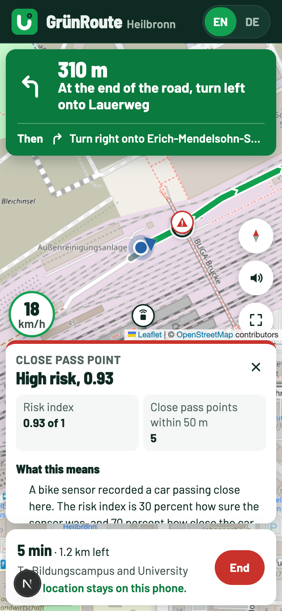
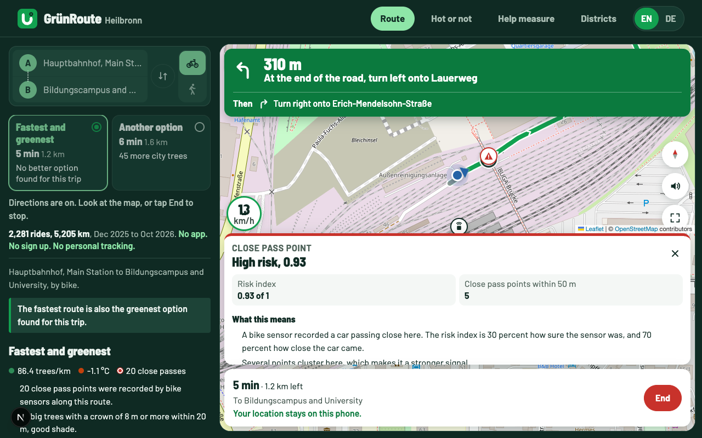
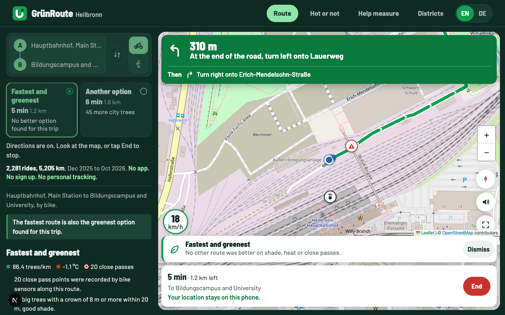
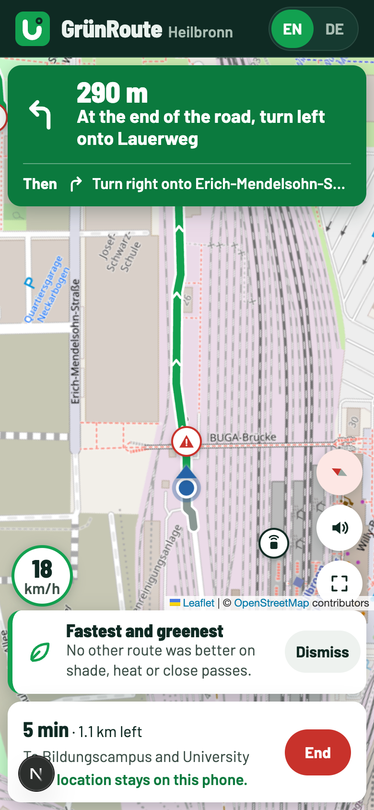
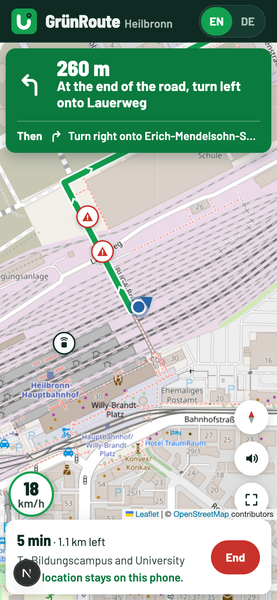
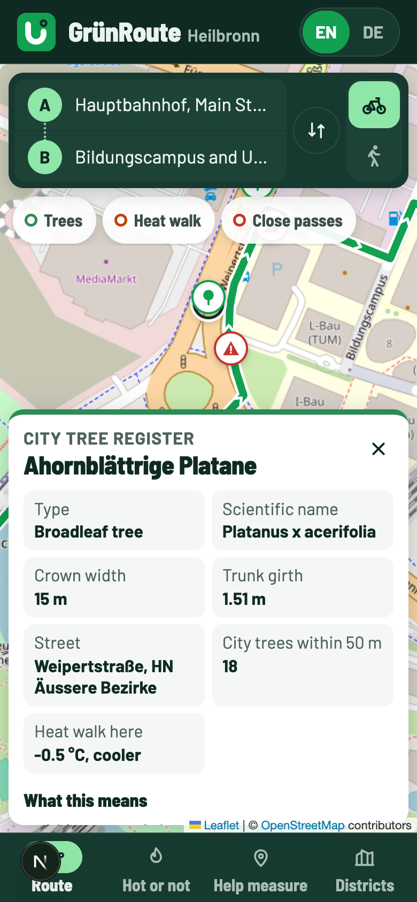

# QA: live directions, map rotation, app icons (28 Oct 2026)

Branch `map-locate`. Tested in a headless Chrome (agent-browser) with a fake GPS that rides the real route point by point, at 390 x 844 (phone) and 1280 x 800 (desktop). Screenshots are in `2026-10-28-nav-rotate-icons/`.

## 1. Signs on the map could not be tapped during directions

Cause: the tap did select the sign, but the directions view had no place to show the card, so nothing appeared.

Fix: the sign card now shows above the trip bar during directions (`NavPanel` `info` prop). The round buttons move up with it. The card is at most 30 % of the screen high so the map stays usable. The map moves so your dot stays in the open part between the turn card and the sign card, also when you stand still.

On desktop, the zoom buttons covered the sound and fullscreen buttons during directions (this was there before). They now sit above the round buttons, and step aside while a sign card is open.

Checked: close pass sign on phone and desktop during directions, tree and close pass sign on the planner view, close button.

## 2. App icons looked wrong when shared or added to the home screen

Cause: the icon PNGs (favicon, apple touch icon, 192, 512, maskable) were placeholders that did not match the logo.

Fix: `scripts/build-icons.mjs` renders all of them from `brand/icons/icon.svg`. The apple icon is a full square (iOS rounds it), the maskable icon keeps the mark in the safe middle. The logo PNGs in `brand/logo/png/` were rebuilt the same way. The manifest got `id`, `scope` and `purpose`, and the page got Apple web app tags.

The social share images in `brand/social/` were already right and were not changed.

## 3. The map could not be rotated

Fix: added the `leaflet-rotate` plugin, pinned to 0.2.8. Newer versions (0.3.0 to 0.5.0) all came out within two days this week after three quiet years, so they were not used. 0.2.8 was read: no install scripts and no network calls.

- Two finger twist rotates on phones. Shift and mouse wheel rotates on desktop.
- A compass button shows when the map is turned. Tap it to turn back to north.
- During directions the compass button also turns on "heading up": the map turns with your direction and your dot sits lower so you see more road ahead. Tap again for north up.
- Markers, labels and popups stay upright. The route arrows and your direction arrow turn with the map.

## 4. Live directions compared with best practice

| Topic | Common practice | GrünRoute before | Now |
| --- | --- | --- | --- |
| Where the dot sits | In the open part of the map, lower when heading up (Mapbox following padding) | Map centre, could be under the cards | Open part, 70 % down when heading up |
| Map orientation | North up or heading up, user picks | North up only | Both, compass button |
| Dot on the line | Snapped to the route when close (map matching) | Raw GPS, jumps beside the line | Snapped within 20 m, raw when further |
| After panning by hand | Map comes back to follow after a short time | Stayed off until tapped | Comes back after 15 s, not while a sign card is open |
| Turn cues | About 150 m before a turn for bikes (Bosch e-bike) | 150 m, 30 m, arrive 20 m | Same |
| Off route | Wait for a few bad readings, ignore poor accuracy | 40 m for 3 readings, ignores readings worse than 80 m | Same |
| Screen awake | Take the wake lock again when the page comes back | Done | Same |

Rerouting stays a button on purpose: it sends your spot to the routing service, so it waits for a tap.

Checked with the fake GPS ride: cues and distances, dot in the open area (card closed and open), heading up turn and dot position, back to north, snap at 10 m off (dot on the line) and no snap at 30 m off, off route after 3 readings at 70 m, re-route button gives a new route from your spot, auto follow 15 s after a hand pan, arrival message. No script errors.

Sources:
- Mapbox navigation camera (following padding, overview north up): https://docs.mapbox.com/android/navigation/api/coreframework/3.31.0/ui-maps/com.mapbox.navigation.ui.maps.camera.data/-mapbox-navigation-viewport-data-source/
- Mapbox turn by turn guide: https://docs.mapbox.com/android/navigation/guides/turn-by-turn-navigation.md
- Wake lock, take it again on visibility change: https://developer.chrome.com/docs/capabilities/web-apis/wake-lock
- Bosch e-bike turn cue distances: https://www.bosch-ebike.com/us/help-center/ebw-kiox300-navigation/asset-ast-00022
- Noisy GPS fixes and false reroutes: https://image-ppubs.uspto.gov/dirsearch-public/print/downloadPdf/9441982
- Users asking for heading up: https://abrp.featurebase.app/p/cannot-switch-to-heading-up-mode-2

## Not checked

- A real phone outdoors with real GPS and a real compass. The ride was simulated.
- Two finger rotate on a real touch screen. Rotation was checked with shift and wheel, and by setting the bearing in code.
- How iOS and Android show the new home screen icon after "Add to Home Screen". The files and tags were checked, not a real install.
- How each social network shows the link preview. They cache old images, so a re-share may take time to update.
