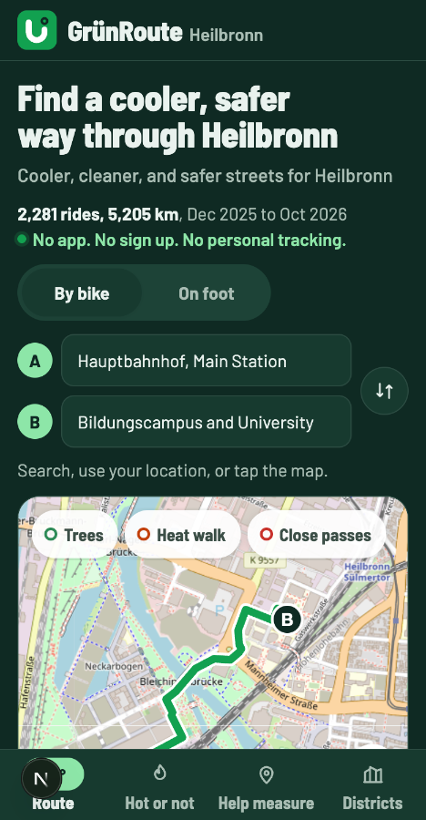
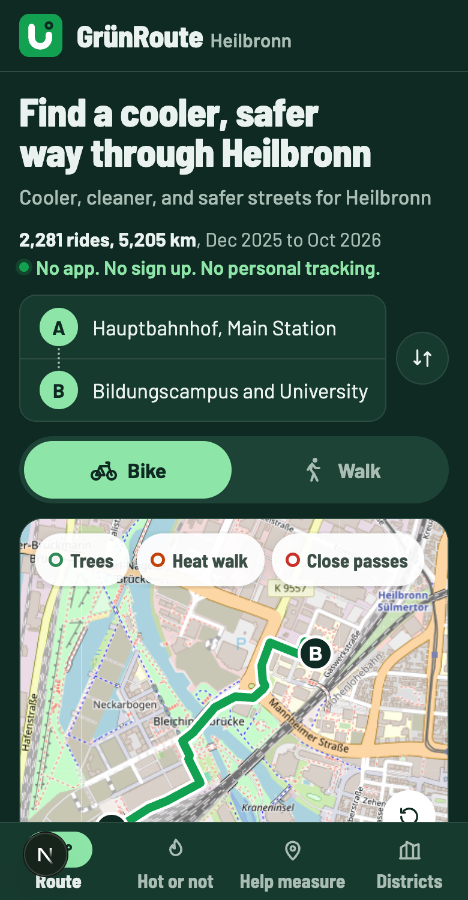
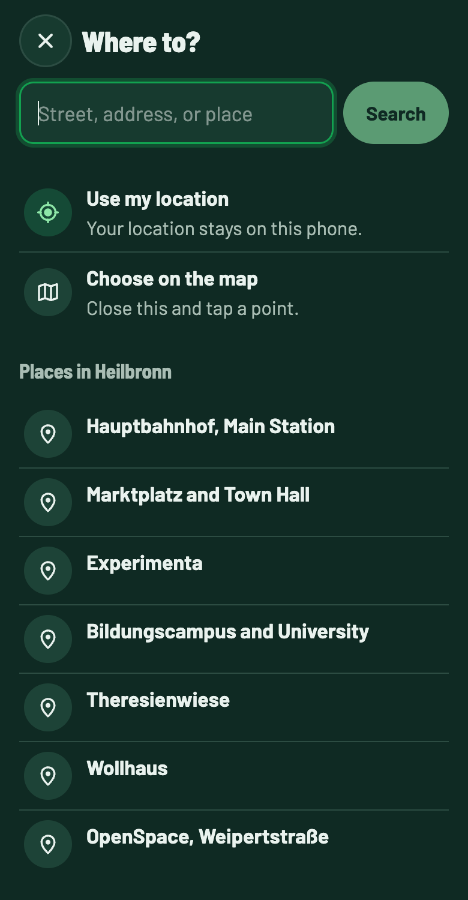
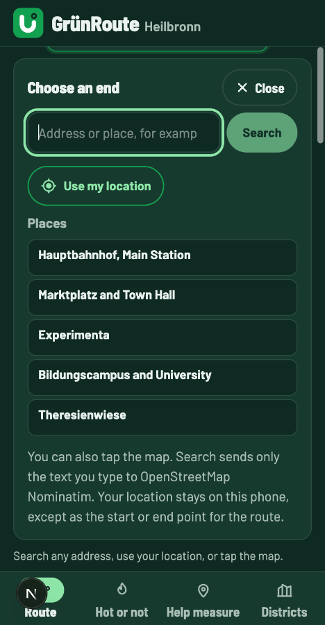
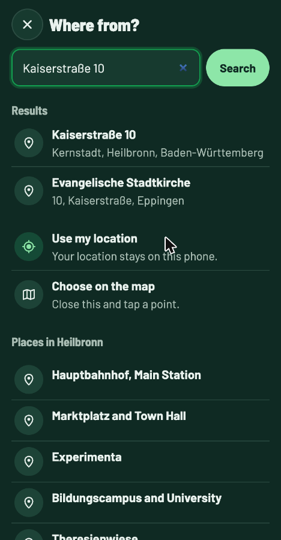
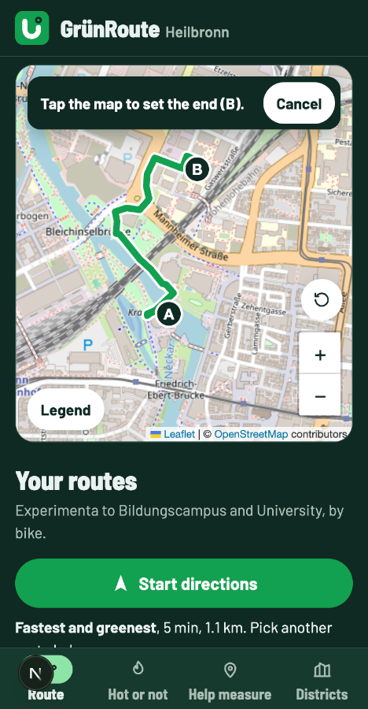
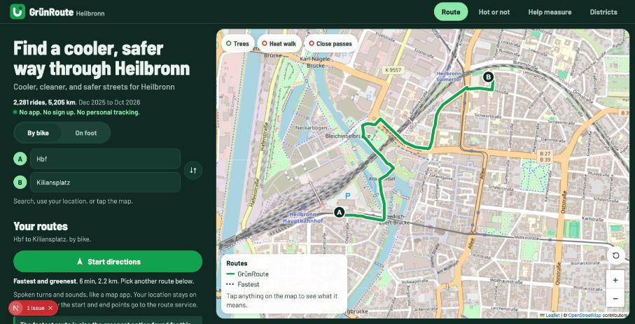
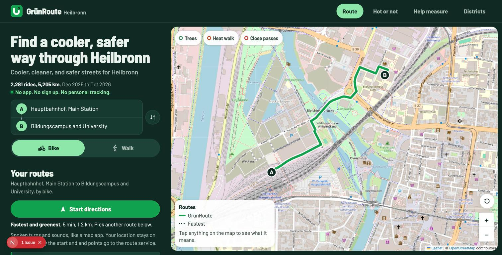
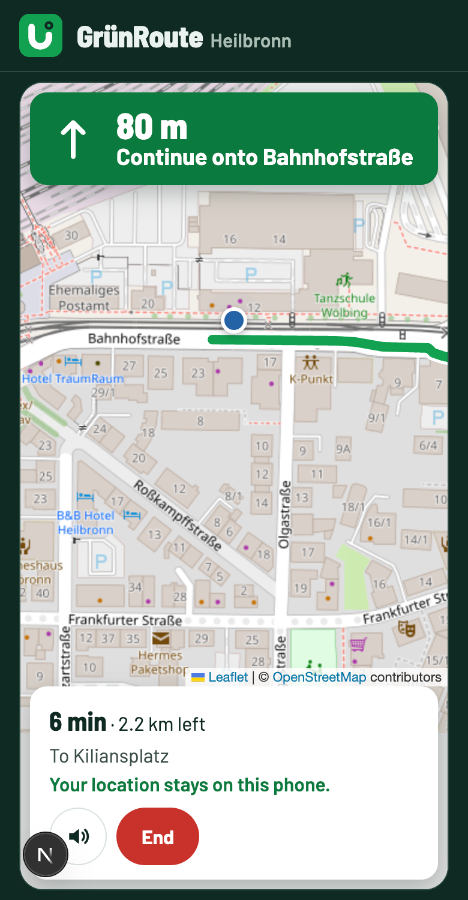

# Trip planner and header, people app, 28 Oct 2026 (branch `trip-ux`)

Scope: the people app only. Nothing in `admin/` changed. Build, lint, and test pass in both.
Widths: 390 x 750 px (an iframe in a desktop Chrome tab) and desktop (1512 x 771 viewport). Chrome ran in dark mode.
Not checked: a real phone, Safari, the on screen keyboard, screen readers.

Images are in [`2026-10-28-trip-planner/`](2026-10-28-trip-planner/).

## What the best map apps do

Short research notes, from news coverage and design reviews of the apps, not from official guidelines.

- **Google Maps** (Android 2024, iPhone 2025): the place search opens full screen. Once start and end are set, the top shows only the two places in one compact box, and the travel mode switch moved lower for easier reach. ([9to5Google, Android](https://9to5google.com/2024/07/14/google-maps-android-redesign/), [9to5Google, iPhone](https://9to5google.com/2025/03/07/google-maps-iphone-sheet-redesign/), [9to5Google, directions search](https://9to5google.com/2024/02/07/google-maps-directions-search-redesign/))
- **Citymapper**: one clear search entry, then quick choices you recognise instead of typing (home, work, saved places). ([Pratt IXD critique](https://ixd.prattsi.org/2026/09/design-critique-citymapper/), [Econsultancy](https://econsultancy.com/six-features-to-appreciate-about-citymappers-ux/))
- **Apple Maps and Google Maps**: the search screen shows quick options under the search box, and "Your location" comes first.
- **Segmented controls** (Primer, GitLab, Telerik design systems): 2 to 5 options, use text with icons together, do not mix, use icons alone only if everyone knows them. ([Primer](https://primer.style/components/segmented-control), [GitLab](https://design.gitlab.com/components/segmented-control))
- **Modal sheets** (Material): they dim the page and must be closed before you touch the page again. ([Material bottom sheets](https://material.io/components/sheets-bottom))

What we took from this:

1. Start and end as one From and To card, with A and B joined by a dotted line and the swap button beside it.
2. A tap opens a search sheet, full screen on phones and a centred dialog on desktop, instead of a panel that pushes the map down.
3. In the sheet: search box first (focused), then Use my location, then Choose on the map, then the known places, all as large rows with icons.
4. Travel mode as a full width Bike and Walk switch, icon plus text, with a filled active state.
5. Not taken: recent or saved places. They would mean storing places on the phone. That changes the privacy behaviour, so it needs the owner's go ahead first.

## Before and after

| Before, 390 px | After, 390 px | Search sheet, 390 px |
|---|---|---|
|  |  |  |

| Old inline picker, 390 px | Search results, 390 px | Choose on the map, 390 px |
|---|---|---|
|  |  |  |

| Before, desktop | After, desktop | Live directions, 390 px |
|---|---|---|
|  |  |  |

## Header

Found: on desktop the logo started at 24 px but the page text at 32 px, and the 44 px tabs had only 6 px above and below them in the 56 px header, so it looked cramped. On phones the header itself was fine.

Changed: 60 px header on phones, 68 px on wide screens, 12 px between the logo and the wordmark and between tabs, and on wide screens the header uses the same 32 px side padding as the page text.

Measured: phones, header 60 px on `/`, `/play`, `/measure`, `/districts`, `/data-collection`, `/?fair=1`. Desktop, header 68 px, logo left 32 px, headline left 32 px, tabs 12 px from the top and bottom, 32 px from the right edge.

## Above the fold at 390 x 750

| | Before | After |
|---|---|---|
| Header | 56 px | 60 px |
| Headline | 2 lines | 2 lines |
| Map top | 454 px | 432 px |
| Tab bar top | 685 px | 685 px |
| Map shown above the tab bar | 231 px | 253 px |
| Page width (scrollWidth) | 390 | 390 |

The trip hint line ("Search, use your location, or tap the map.") is gone. The sheet now shows those choices, and the map popup still offers Start (A) and End (B) on any tap.

## Checks

In the browser (local `next dev`):

- Sheet opens on a tap of From or To, the search box gets focus, the page behind does not scroll.
- Escape, the Close button, a tap on the backdrop (desktop), and picking a place all close it and return focus to the row (`trip-start` or `trip-end`).
- Search for "Kaiserstraße 10" ran once on submit and listed 2 results.
- Choose on the map: the sheet closed, the page scrolled to the map, the bar said "Tap the map to set the end (B).", one real click set B to "Point on the map (B)" and the routes reloaded.
- Text under 16 px: 0 on `/`, `/play`, `/measure`, `/districts`, and inside the sheet (map attribution excluded). Tap targets under 44 px: none on those pages or in the sheet.
- Live directions with a simulated position (injected in the test tab only): turn banner, bottom bar, and attribution fit with the taller header; From, To, and the Bike and Walk switch are disabled while directions run.
- Console: only the known hydration warning from a browser extension attribute on `<body>`.

Commands: `npm run lint`, `npm test` (41 of 41), `npm run build` pass in the root; `npm run lint`, `npm test` (18 of 18), `npm run build` pass in `admin/`.
