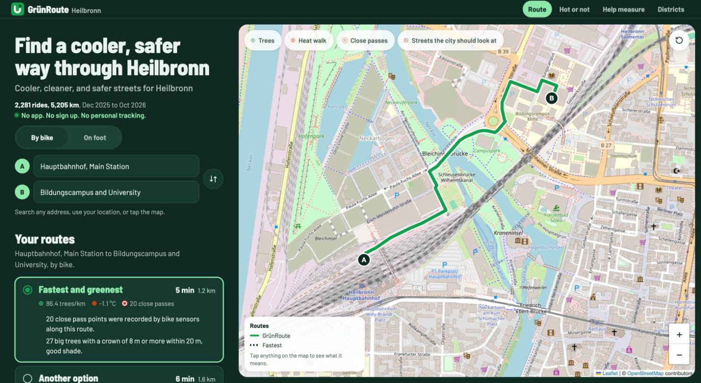
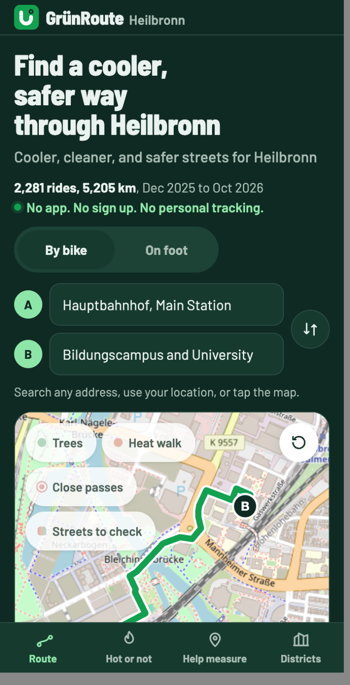
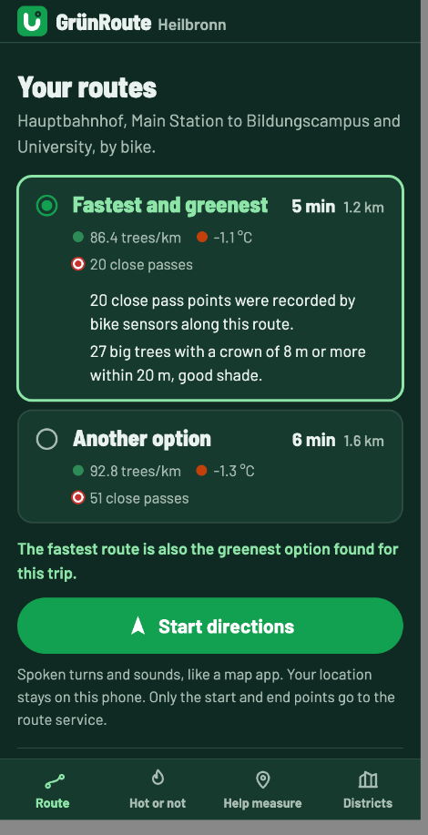
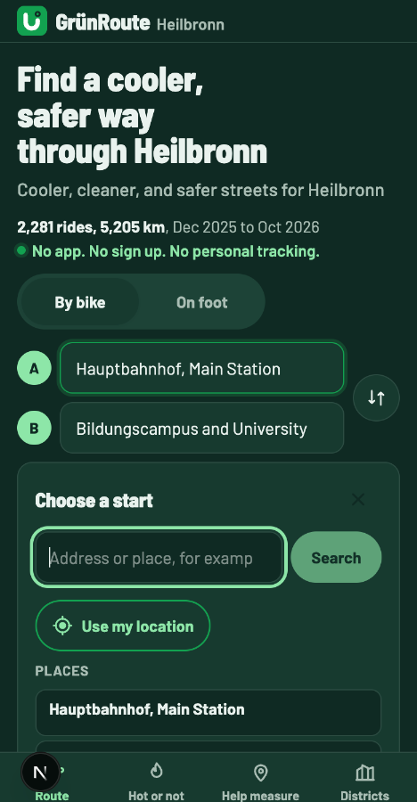
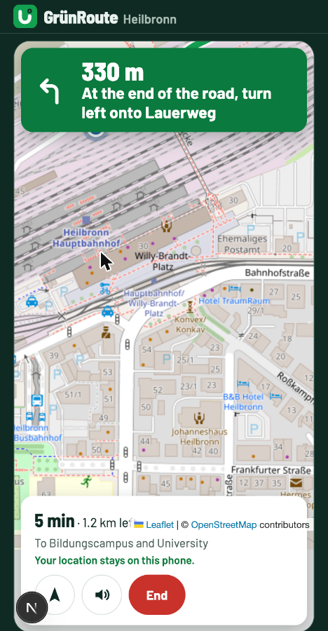
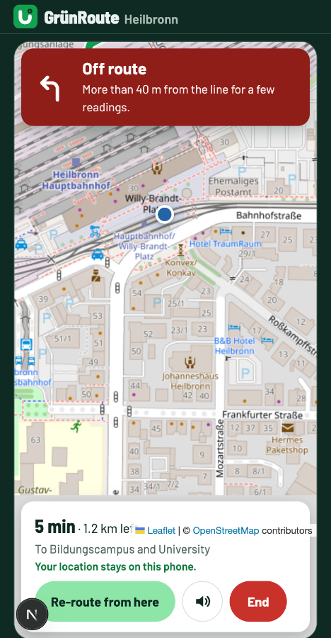

# UX review, people app, 28 Oct 2026 (branch `ux-pass`)

Scope: the people app at the repo root. Pages `/`, `/play`, `/measure`, `/districts`, `/data-collection`, `/?fair=1`.
Widths: 390 x 750 px (an iframe inside a desktop Chrome tab, because Chrome windows cannot go below 500 px) and desktop (1440 x 900 window).
Method: real Chrome via Claude in Chrome, on the live site (before Part 1) and a local `next dev` of `ux-pass` (after Part 1, before Part 3). Measurements come from `getBoundingClientRect` and `getComputedStyle` in the page. Code was checked against the Vercel Web Interface Guidelines (web-design-guidelines skill). The browser ran in dark mode, so most screenshots show the dark theme.

Not checked: a real phone, Safari, a light mode pass of every page, screen readers. Live directions used a simulated position injected in the test tab only.

Images are in [`2026-10-28-ux-review/`](2026-10-28-ux-review/).

## Before

| Desktop, live site | 390 px, live site | 390 px, routes and Start |
|---|---|---|
|  |  |  |

| Picker open, 390 px | Live directions, 390 px | Off route, 390 px |
|---|---|---|
|  |  |  |

Key numbers at 390 x 750 (local, after Part 1):

- Header 40 px. Logo mark 28 px, "GrünRoute" 21 px, "Heilbronn" 15 px.
- Bottom tab bar 56 px, labels 12 px, active tab shown by colour only (mint against grey mint).
- Map top at 465 px, tab bar top at 694 px, so about 230 px of map shows above the fold.
- Layer chips wrap to 2 rows (Trees, Heat walk / Close passes) and cover about 100 px of that map. On the live site, with the 4th chip, they took 3 rows.
- Start directions sits about 1,500 px down the page, under both route cards.
- 18 text elements in the first screen are under 16 px, 117 on the whole home page, 66 on `/measure`, 171 on `/districts` (mostly 14 and 15 px, plus 12 and 13 px labels).
- No horizontal overflow on any page (scrollWidth 390 on all six).

## Findings, ranked by impact

### High

1. **Live directions: the map attribution sits on top of the trip status.** At 390 px the "Leaflet | © OpenStreetMap contributors" line covers "1.2 km left" in the bottom bar (see the live directions shots). The zoom and attribution block is pushed up a fixed 120 px, but the bar is 153 px tall. Fix: measure the bar and keep the attribution just above it.
2. **Live directions, off route: the banner keeps the old turn arrow and the action is far away.** The red banner says "Off route" but still shows the left turn arrow. "Re-route from here" is in the bottom bar, about 650 px below the banner that tells you about the problem, and the sub line is 14 px. On a bike this is hard to read and to reach. Fix: a warning icon in the banner, the Re-route button inside the banner, sub text 16 px.
3. **Start directions is hard to find after routes load.** On a phone it sits below the map and both route cards, about two screens down, with nothing near the map that says you can start. Fix: a compact Start button right under the map on phones (the first thing after the map), keep the full button with the privacy note under the cards.
4. **Header is too small.** 40 px high, 28 px logo and a 21 px wordmark. Nav links on desktop are 36 px tall (under 44 px). Fix: 56 px header, 36 px logo, 24 px wordmark, 44 px tabs with more space and a clearer active state.
5. **Layer chips cover too much of the phone map.** Two rows at 390 px over a map that shows only about 230 px above the fold. The on state is only a thin ink border, the off state a faded dot, so on and off look alike. Fix: one row, 16 px labels, a filled on state with a tick, and move the reset button to the bottom right so the chips get the full width.
6. **Text under 16 px where people need to read it.** Trip hint (14), route stats and km (14), "How routes are chosen" (14), the privacy note under Start (14), picker notes and labels (13), legend (12 and 13), info card labels and sources (12), nav "To ..." (14) and privacy line (13), tab bar labels (12), and many 15 px lines on `/measure`, `/districts`, `/play`, and `/data-collection`. Fix: raise read text to 16 px. Keep tiny text only for the map attribution.

### Medium

7. **Bottom tab bar: active tab is colour only, labels 12 px.** Fix: 16 px condensed labels, a mint pill behind the active icon, 64 px tall.
8. **Place picker: focus is lost on close.** Escape and the close button remove the panel and focus falls to `<body>` (checked in the browser). The picker also pushes the map below the fold while open (map top moves from 465 to 1,009 px), which is fine because you can still tap the map after closing, but the close button is a dim 44 px icon. Fix: return focus to the A or B button that opened it; make the close button clearer.
9. **Re-centre button in live directions is an unlabelled arrow icon.** It has an aria-label, but on screen it looks like a compass or a "go" button. Fix: icon plus the word "Centre".
10. **Route cards: the difference between GrünRoute and Fastest is hard to see.** The stats are 14 px grey, and the comparison line sits under both cards. When GrünRoute is also the fastest, the second card is called "Another option" with no hint why it is worse. Fix: larger stats, and keep the compare line short and right under the cards (no change to numbers or the rule).
11. **Legend on phones:** the "Tap anything on the map to see what it means." hint is hidden under 1024 px unless the legend is opened, and the legend text is 12 px. Fix: 16 px legend text, keep the hint in the opened legend.
12. **Reset map view button:** an icon only button at the top right that competes with the chips. Fix: move it to the bottom right, above the zoom buttons, with the same 44 px size.

### Low

13. Loading text uses three dots (`...`) instead of the ellipsis character in a few places (Home, NavPanel, PlacePicker, Measure, Play). Kept as is, it reads fine and is plain ASCII.
14. `/?fair=1` tour: no issues found at 390 px. Step dots are not buttons, the whole screen is the tap target.
15. Skeletons: the map and the route cards already have shimmer skeletons that stop under reduced motion. No change.
16. Contrast: the checked pairs pass WCAG AA. Off layer chip text #4f635a on white about 6.2:1, moss #a9bdb3 on ink #0f2a23 about 9:1.

## Code check, Web Interface Guidelines

components/PlacePicker.tsx

- components/PlacePicker.tsx:67 - dialog closes without returning focus to its trigger
- components/PlacePicker.tsx:121 - picker note 13 px, read text

components/NavPanel.tsx

- components/NavPanel.tsx:59 - off route banner keeps the turn arrow icon
- components/NavPanel.tsx:73 - "Re-route from here" far from the off route message
- components/NavPanel.tsx:84 - icon only re-centre button, label only in aria-label

components/AppNav.tsx

- components/AppNav.tsx:31 - active tab shown by colour only

app/globals.css

- app/globals.css:34 - header 40 px, small brand
- app/globals.css:444 - layer chips wrap to 2 rows at 390 px
- app/globals.css:470 - on and off chip states too alike
- app/globals.css:613 - desktop tabs 36 px tall (under 44 px)
- app/globals.css:627 - tab bar labels 12 px
- app/globals.css:735 - zoom and attribution offset is fixed at 120 px, the nav bar is taller
- app/globals.css:247 - `.search input` sets `outline: 0`, but its wrapper has a `:focus-within` ring, pass

Pass: `:focus-visible` ring on all controls, `touch-action: manipulation` on buttons, reduced motion handled, no `transition: all`, inputs have labels, Nominatim search only on submit, no zoom lock in the viewport meta.
